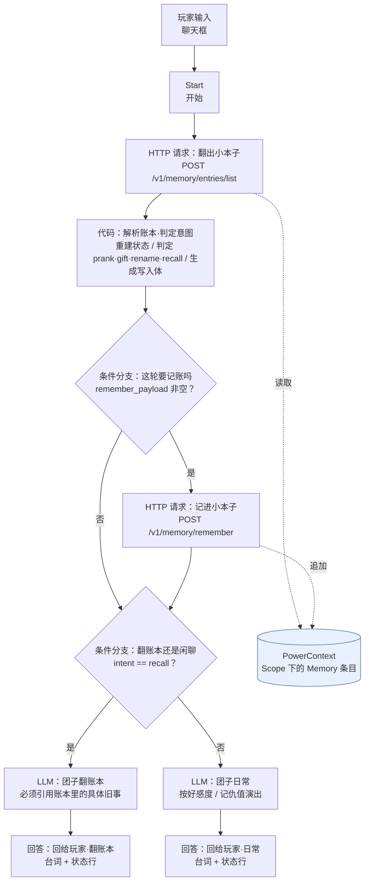

# 技术说明 · 打烊之后 · 便利店夜班 NPC

配套文件：`README.md`（运行与验收）、`dsl/night-store-npc.yml`（Dify DSL）。

---

## 1. 设计出发点

赛题要求"Dify 承担核心流程编排"且"实际使用 PowerContext"。最容易滑向的写法是：
把 PowerContext 当成一块 KV，把"上一轮说了什么"整段塞进去。这样看起来用了长期记忆，
实际上记忆只是被搬运，没有真正参与决策。

本作品的做法相反：

> **Dify 只做编排与呈现，长期记忆只存"值得记住的事实"，状态永远由记忆现算。**

具体地，团子的好感度和记仇值**不存在任何变量里**。每轮对话开始时，
工作流先把整个账本从 PowerContext 读回来，对所有事件条目的增量求和，得到当前状态；
状态和账本摘要一起进 LLM 提示词。于是：

- 任何一轮的台词都由**长期记忆的内容**决定；
- 换一个 Dify 会话、甚至换一台机器连同一个 scope，状态依然自洽；
- 记忆不是"上下文"，而是**决策依据**。

---

## 2. 架构



---

## 3. 节点职责

| 节点 id | 类型 | 职责 | 关键输入 | 关键输出 |
| --- | --- | --- | --- | --- |
| `start` | start | Chatflow 入口，玩家的一句话走 `sys.query` | — | — |
| `http_ledger` | http-request | 读回整本小本子 | `env.PC_BASE_URL`、`env.PC_SCOPE_ID` | `body`（账本 JSON） |
| `code_ledger` | code | 从账本重建状态；规则判定意图；生成写回请求体 | `sys.query`、账本 JSON、`env.PC_SCOPE_ID` | `intent` / `npc_name` / `warmth` / `grudge` / `event_count` / `ledger_digest` / `state_digest` / `status_line` / `remember_payload` |
| `if_write` | if-else | 分流：本轮是否产生了值得长期记住的事 | `code_ledger.remember_payload` 非空 | `true` / `false` |
| `http_remember` | http-request | 追加一条记忆到 PowerContext | `code_ledger.remember_payload` | `body`（写入回执） |
| `if_route` | if-else | 分流：翻账本 / 日常闲聊 | `code_ledger.intent == recall` | `true` / `false` |
| `llm_recall` | llm | 翻账本分支的台词：必须引用账本里的具体旧事，不得编造 | `state_digest`、`ledger_digest`、`sys.query` | `text` |
| `llm_chat` | llm | 日常分支的台词：按好感度与记仇值演出 | `state_digest`、`ledger_digest`、`sys.query` | `text` |
| `answer_recall` | answer | 输出台词 + 状态行 | `llm_recall.text`、`code_ledger.status_line` | — |
| `answer_chat` | answer | 输出台词 + 状态行 | `llm_chat.text`、`code_ledger.status_line` | — |

节点数 10，边数 10。

---

## 4. 数据流

一轮对话的完整数据流（`→` 表示数据方向）：

```
sys.query（玩家原话）
  └─→ code_ledger.player_input
        │
http_ledger.body（账本 JSON：{entries: [...]}）
  └─→ code_ledger.ledger_json
        │
env.PC_SCOPE_ID ─→ code_ledger.scope_id
        │
        └─→ code_ledger 产出 9 个输出
              ├─ intent ─────────────→ if_route 条件
              ├─ remember_payload ───→ if_write 条件 ─(true)→ http_remember.body
              ├─ state_digest ───────→ 两个 LLM 节点的 system 提示词
              ├─ ledger_digest ──────→ 两个 LLM 节点的 system 提示词
              ├─ npc_name ───────────→ 两个 LLM 节点的 system 提示词
              └─ status_line ────────→ 两个 Answer 节点的模板
```

### 关键点：状态是算出来的，不是存出来的

`code_ledger` 对账本里的每一条 `npc-event` 做增量求和：

```text
warmth = Σ(所有 npc-event 条目的 warmth 字段)
grudge = Σ(所有 npc-event 条目的 grudge 字段)
npc_name = 最后一条 npc-name 条目的 name 字段（缺省「团子」）
```

因此**不需要**任何"更新状态"的写操作，也不会出现状态与记忆不一致的情况。
PowerContext 的 Memory 是只追加（append-only）的历史流，状态是它的投影。

---

## 5. 记忆 schema 设计

### 5.1 Scope 划分

| 层级 | 取值 | 含义 |
| --- | --- | --- |
| Scope | 一个存档 | 团子的这一本小本子；不同存档互不干扰 |
| Artifact | `memory` | 由 PowerContext 自动维护，本作品不直接操作 |
| Entry kind | `npc-event` | 一次值得记住的互动 |
| Entry kind | `npc-name` | 玩家给 NPC 起的新名字 |

### 5.2 Entry 正文格式

```text
npc-event:
  type=prank; warmth=-1; grudge=2; say=我把货架上的布丁按颜色排成彩虹了，还给价目表画了两撇胡子。
  type=gift; warmth=2; grudge=0; say=给你带了根猫条，还有热豆浆。

npc-name:
  name=小笼包
```

字段说明：

| 字段 | 类型 | 说明 |
| --- | --- | --- |
| `type` | 枚举 | `prank` / `gift`，决定状态增量的语义来源 |
| `warmth` | 整数 | 本次互动的好感增量（-1 / +2） |
| `grudge` | 整数 | 本次互动的记仇增量（+2 / 0） |
| `say` | 文本 | 玩家原话（截断 160 字，半角 `;` `=` 替换为全角以免破坏解析） |
| `name` | 文本 | NPC 当前名字 |

### 5.3 为什么用"键值对 + 分号"而不是 JSON

正文存在 Memory 的 `text` 字段里，PowerContext 会做 Unicode NFC 规范化并去首尾空白。
用 `key=value; key=value` 这种极简格式有三个好处：

1. 人可以直接在 Dashboard 里读懂条目内容（评审友好）；
2. 解析只需要 `split(";")` + `split("=", 1)`，Code 节点里没有额外依赖；
3. 字段顺序无关，将来加字段（如 `turn=`、`mood=`）不会破坏旧条目的解析。

如果 PowerContext 将来提供结构化字段（tag 等），可以平滑迁移到 `kind` + tag 的方案。

---

## 6. 接口契约

作品只依赖两个 PowerContext HTTP 接口。

### 6.1 读账本

```http
POST {PC_BASE_URL}/v1/memory/entries/list
Content-Type: application/json
Authorization: Bearer {PC_AUTH_TOKEN}     # 未开鉴权时可留空

{"scope_id": "<scope_id>"}
```

响应：

```json
{
  "memory": { "family": "memory", "artifact_id": "..." },
  "entries": [
    {
      "citation": { "memory_ref": {...}, "entry_id": "...", "entry_version_id": "..." },
      "version": 1,
      "kind": "npc-event",
      "text": "type=prank; warmth=-1; grudge=2; say=...",
      "state": "active",
      "source_refs": [],
      "artifact_refs": []
    }
  ]
}
```

### 6.2 写记忆

```http
POST {PC_BASE_URL}/v1/memory/remember
Content-Type: application/json
Authorization: Bearer {PC_AUTH_TOKEN}

{
  "scope_id": "<scope_id>",
  "kind": "npc-event",
  "text": "type=prank; warmth=-1; grudge=2; say=...",
  "reason": "Dify 夜班便利店 NPC：把本轮互动写进长期记忆"
}
```

响应返回精确 citation（`memory` + `entry`）。本作品不修改、不停用条目，
所以不需要传回 citation。

### 6.3 与 Dify HTTP 节点的对接细节

Dify 的 HTTP 节点在 `body.type: json` 时要求 `data` **恰好一项**，
其 `value` 是**整段 JSON 字符串**，运行时先做变量替换再 `json.loads`。
因此本工作流的写法是：

- **读账本**：body 是常量 JSON，里面的 scope_id 用 `{{#env.PC_SCOPE_ID#}}` 插值
  → `{"scope_id": "{{#env.PC_SCOPE_ID#}}"}`；
- **写记忆**：body 整体就是 `{{#code_ledger.remember_payload#}}`，
  这段 JSON 由 Code 节点用 `json.dumps` 生成 → 玩家输入里的引号、换行不会破坏 JSON。

---

## 7. 意图判定规则

`code_ledger` 里是纯关键词规则，不依赖模型，因此行为可预期、可验收。

| 优先级 | 意图 | 触发条件（任一命中） |
| --- | --- | --- |
| 1 | `recall` | 记得 / 还记得 / 上次 / 以前 / 小本子 / 干过什么 / 你叫 / 叫什么 … |
| 2 | `rename` | 命中改名正则 `叫X`，或出现 改名 / 换个名字 / 你的名字 / 取个名 |
| 3 | `prank` | 恶作剧 / 整蛊 / 彩虹 / 排成 / 按颜色 / 橡皮筋 / 弹珠 / 便利贴 / 画胡子 / 偷吃 … |
| 4 | `gift` | 猫条 / 小鱼干 / 奶茶 / 咖啡 / 豆浆 / 礼物 / 擦玻璃 / 夸奖 / 喜欢你 … |
| 5 | `smalltalk` | 以上都不命中（兜底） |

改名正则：

```text
(?:以后|今后|从今天起|从现在起)?\s*(?:你)?\s*(?:就)?\s*叫\s*([^\s,，。.!?！？、"'"“”]{1,12})
```

捕获到的名字会去掉尾部语气词（吧/啦/呀/啊/呢/哦/嘛/喔/咯）。

规则的局限是显然的：同义表达可能漏判、复杂句子可能误判。
这是刻意的取舍——**判定稳定比判定聪明更重要**，因为验收要能复现。

---

## 8. 扩展方向

按投入产出排序：

1. **换成 `/v1/memory/search` 做语义召回**
   当前用 `entries/list` 全量拉取（保证确定性、且不需要 Embedding）。
   条目变多后可以改用 `POST /v1/memory/search`（`mode: hybrid`）先做相关性召回，
   再由 Code 节点做状态累加。PowerContext 侧只需配置向量检索即可，无需改 DSL 结构。
2. **引入"剧情进展"这一层记忆**
   现在只记了事件与名字。可以再加 `kind=npc-plot`，记主线进度
   （例如"第 3 夜、店长明天来查岗"），让 NPC 能对剧情做出反应。
3. **多 NPC / 多角色**
   一个存档里放多个 NPC，每个 NPC 用不同的 `kind` 前缀区分，
   状态统计时按前缀过滤即可。
4. **玩家偏好单独成一条记忆**
   例如玩家说"我讨厌香菜"，写入 `kind=npc-preference`，
   LLM 提示词里把偏好单独列一段。
5. **用 `/v1/sources/content` 留下原始证据**
   PowerContext 的 Source → Memory 是自动抽取链路。
   把玩家原话同时作为 Source 采集，可以让"这条记忆是从哪句话来的"可追溯。
6. **接 Dashboard 做运营视图**
   PowerContext 自带 Dashboard，能直接看到每个 scope 的记忆条目与使用统计，
   评审现场可以直接翻团子的账本。
7. **把意图判定升级为 Dify 的问题分类器节点**
   当前用规则是为了确定性。若换成 `question-classifier` 节点，
   可以让模型判定意图，同时保留规则作为低置信度兜底。

---

## 9. 已知限制

| 限制 | 说明 |
| --- | --- |
| 意图判定是关键词规则 | 同义表达可能漏判；见第 7 节 |
| 全量拉取账本 | 条目数很大时 `entries/list` 的响应会变大；见扩展方向第 1 条 |
| 状态用累加实现 | 不支持"撤销某件事"；PowerContext 的 revise/retire 可以做，但工作流目前没接 |
| 只追加不修改 | 改名是新增一条 `npc-name` 而不是改旧的；同名以最后一条为准 |
| 台词由模型决定 | 提示词约束了"必须引用账本旧事、不得编造"，但具体措辞不可预期 |
| `advanced-chat` 的 mode 取值 | Dify 中 Chatflow 应用的 mode 就是 `advanced-chat`，`chatflow` 不是合法枚举值 |
